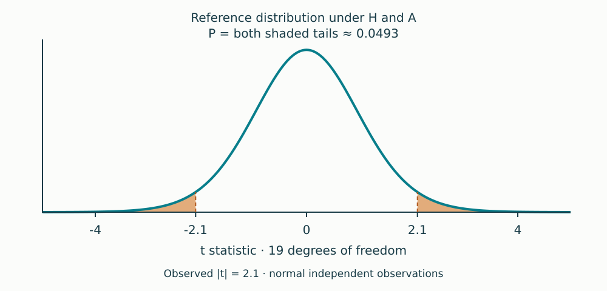

# Greenland (2016) biomathematics lunch

The deck contains **36 slides: a title, eight introductory slides, one slide for each of the 25 misconceptions, and two closing slides**. The misconceptions follow the paper's original order. The presenter's edits are preserved in the notebook, which is now the source of truth.

The introduction covers models and tests, notation, probabilities of hypotheses versus data, assumptions, compatibility, significance/surprisal, and confidence intervals. A standalone slide after the notation shows a two-tailed Student t illustration (19 degrees of freedom, observed |t| = 2.1, P ≈ 0.0493). The CI explanation includes a P-value compatibility curve for estimate 3 with known SE 2, yielding a 95% interval of approximately −0.92 to 6.92. These are illustrative calculations, not biological data from the paper.

Each misconception slide contains a brief paraphrased claim, correction, takeaway, page citation, and speaker notes. Numbering matches the paper: 1–14 P values, 15–18 comparisons and replication, 19–23 confidence intervals, and 24–25 power.

The two closing slides quote part of guideline (g) on p. 347 and summarize the six principles of the ASA's 2016 statement on P values. Both include source links and speaker notes.

The surprisal transform is an explicitly labeled addition from Rafi & Greenland (2020), [Semantic and cognitive tools to aid statistical science](https://pmc.ncbi.nlm.nih.gov/articles/PMC7528258/).

## Files

- `greenland_2016_slides.ipynb`: editable Quarto notebook; all slide content lives here.
- `greenland_2016_slides.html`: self-contained Reveal.js presentation.
- `figures/p_value_tails.svg`, `figures/ci_compatibility.svg`: reproducible diagrams.
- `scripts/create_figures.py`: figure generator using Python's standard library.
- `slides.css`: styling.
- `SUMMARY.md`: separate full-paper summary.

## Sample-size simulation for misconception #7

Open `misconception_07_sample_size.ipynb` in Jupyter with a Python 3 kernel and run all cells. Install its dependencies in that environment with `python -m pip install -r requirements-simulation.txt` if needed.

The separate notebook fixes a tiny true effect (0.001 SD), varies N from 100 to 100 million independent observations, and repeats 10,000 studies at each N. It plots P versus N with Monte Carlo variation and the fraction of significant results, alongside a zero-effect control and exact theoretical power. It also reports effect estimates and a fixed-estimate reference table with confidence intervals. Parameters and seeds are editable; exact simulation of normal sample means keeps the largest sample sizes fast.

## Build and present

With Quarto installed (tested with 1.6.39), Python 3, and GNU Make 4.3 or later:

```sh
make               # build figures as needed, then HTML
make preview       # preview server
make regenerate    # refresh figures; preserves notebook edits
make clean         # remove generated HTML
```

The notebook is edited directly. No command recreates or overwrites its content. The legacy `scripts/create_notebook.py` now only refreshes figures. Python packages and a Jupyter kernel are not required for rendering.

Open the HTML in a current browser with MathML support. Press **S** for presenter view and **O** for overview. Figures, styles, scripts, and native math are embedded in the HTML. Citation links require internet only if clicked.

The original `codex_container` make target remains available. Quarto cache/data stay under `.cache` and `.local/share` for container compatibility.

## Source

Greenland S, Senn SJ, Rothman KJ, Carlin JB, Poole C, Goodman SN, Altman DG. (2016). *Statistical tests, P values, confidence intervals, and power: a guide to misinterpretations.* European Journal of Epidemiology 31:337–350. DOI: 10.1007/s10654-016-0149-3. Based on the supplied `greenland_2016.pdf`.

The build, original-slide preservation, all 25 item numbers, embedded diagrams, and numerical examples were checked. Browser preview is recommended on the presentation machine.

## Editing figure slides

Use Pandoc attributes separated by spaces, without commas:

```markdown
{fig-alt="Accessible description"}
```

The `.full-figure-slide` class handles full-width image sizing in `slides.css`, preserving the SVG aspect ratio. The diagrams use a wide 1000×480 viewBox so the plots occupy the slide without a fixed pixel-height cap. A figure does not need `:::` wrappers. For an explicit Div, write `::: {.classname}`, a blank line, its contents, another blank line, then a closing `:::`. Remove both ends when removing a column or Div. Each standalone figure here has its own level-two heading and notebook cell.
